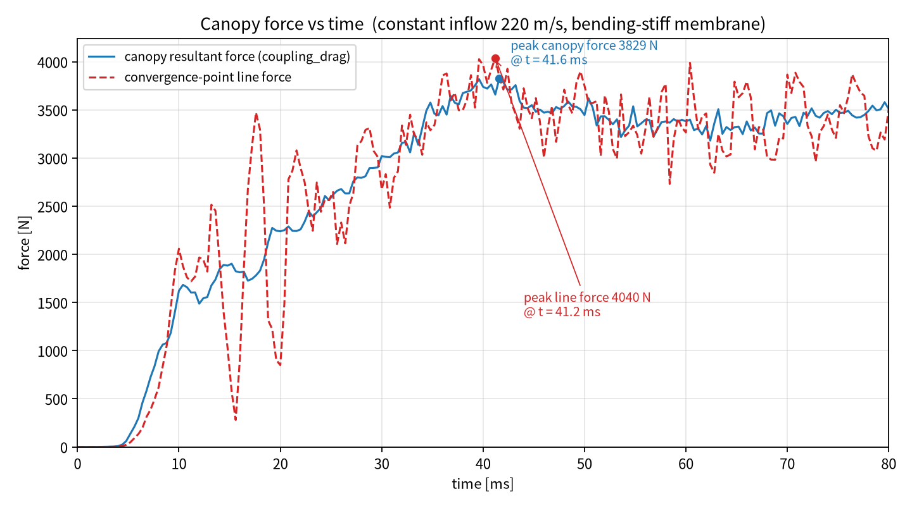
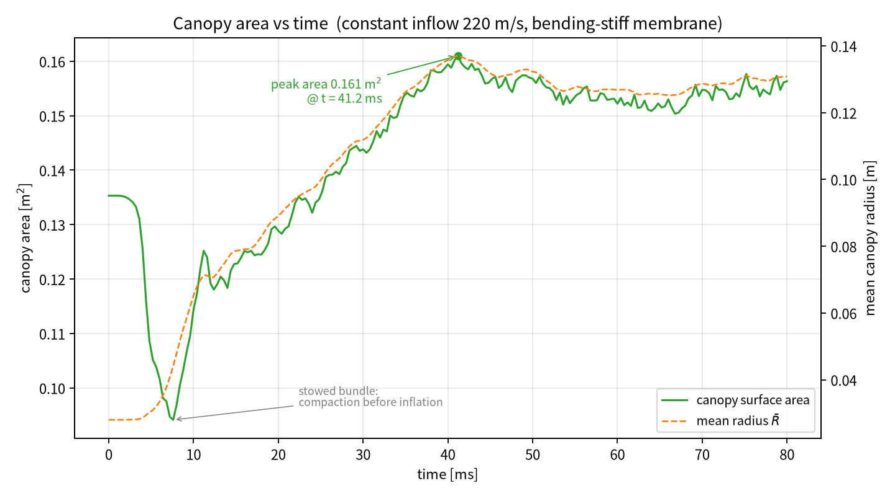

# T5B：修复无反射出口 ghost 状态后重算 80 ms

本交付包对应请求：

> 按方案 A 修复 ghost 状态并重新计算 80 毫秒，输出伞力–时间曲线和伞面积–时间变化的 PNG 图片。

在 T5 工况（恒定 220 m/s 来流 + `bend_scale=1` 边铰弯曲刚度）基础上，只改动
`aleparachute/fluid.py::_ghost_states()` 的出口 ghost 能量赋值，其余参数完全一致，
以便把“数值边界假象”的影响干净地分离出来。

---

## 1. 修复的问题：出口 ghost 状态把内能写进了总能量槽

旧实现（T5 及之前所有算例）：

```python
UG[out, 0]    = rho_ref
UG[out, 1:4]  = rho_ref * u_L          # 零阶外推速度
UG[out, 4]    = e_int_ref              # ← 错误：把“内能”写进“总能量”槽
```

`UG` 的第 4 个分量是**单位体积总能量** `ρE = e_int + ½ρ|u|²`，而 `e_int_ref`
只是内能。用理想气体 EOS `p = (c4 + c5·μ)·e_int` 反算时，ghost 压力变成

$$p_g = 0.4\left(e_{\rm int} - \tfrac12\rho u^2\right)
= 0.4\left(253250 - \tfrac12\cdot1.225\cdot220^2\right)
= 89.4\ \text{kPa},$$

而不是应有的 100 kPa。220 m/s 的整条来流因此被“冷却”了约 10.6 kPa；
诊断里长期出现的 `p_min ≈ 89 kPa` 正是这个边界假象，**不是物理尾迹真空**。

修正后（`fluid.py` L178-198）：

```python
# -- non-reflecting outflow: ambient ghost state -------------------
out = bc == 1
if out.any():
    g = self.gas
    rho_g = g.rho0
    u_g = U_L[out, 1:4] / np.maximum(U_L[out, 0:1], 1e-30)
    UG[out, 0]   = rho_g
    UG[out, 1:4] = rho_g * u_g
    UG[out, 4]   = g.e0 + 0.5 * rho_g * np.sum(u_g ** 2, axis=1)  # 内能 + 动能
return UG
```

此时 `p_g = 0.4·e0 = 100000 Pa`，与环境初值严格一致。

---

## 2. 方案 A 与最终方案 A′

| 方案 | 做法 | 结果 |
|---|---|---|
| **A（纯零阶外推）** | 出口 ghost 完全取内部状态，`return UG` 不改动 | 16.4 ms 时 R 只剩 0.0165 m、`p_max` 2.11e5 Pa、伞衣合力仅 207 N（伞衣被压塌） |
| **A′（最终采用）** | 速度零阶外推，密度/总能量锚定到环境态 | 20 ms 时 drag 2239 N、R 0.0891 m、`p_max` 118.2 kPa，与旧算例同刻 2238 N 量级一致，且 89 kPa 假象消失 |

**为什么放弃纯 A**：本算例计算域只有 R=0.2348 m（伞衣投影 0.066 m²，通道截面 0.173 m²，
阻塞比约 38%），环形通道面积 0.112 m²，220 m/s 来流对应 M≈0.65 已接近壅塞。
出口若完全透明、失去压力锚定，上游腔室在 16 ms 内即被憋到 2 bar，反而把伞衣压塌。
A′ 保留环境压力锚定（物理上相当于远场静压），只修正能量槽的写法，是窄域下自洽的选择。

> 若把计算域半径扩大到 0.5 m 以上（阻塞比降到 ~5%），纯 A 才是更合适的远场边界条件。

---

## 3. 工况设置（与 T5 相同，仅 ghost 修正）

| 项目 | 取值 |
|---|---|
| 结构模型 | `Parachute_F28.k`（`*MAT_FABRIC` EA=4.309e7 Pa，EB=0.05·EA，PRBA=0.14，t=0.9 mm） |
| 壳理论 | ELFORM=5，THEORY=5，BWC=2 |
| 弯曲刚度 | 边铰弯曲，`--bend-scale 1.0`，`--bend-damp 0` |
| 来流 | **恒定 220 m/s**（`--constant-vel 220`） |
| 膜本构 | `--tension-only-membrane`、`--eb-frac 0.05`、`--vent-radius 0.04` |
| 计算域 | `--nx 16 --ny 28 --nz 16`，R=0.2348 m 圆柱，外表面无反射 |
| 时间步 | `--tssfac 0.8`，实际 dt ≈ 1.0e-6（结构/接触控制，dt_f ≈ 6.3e-6） |
| 结束时间 | 80 ms，**69746 步，墙钟 5548.5 s** |
| 状态输出 | 每 10 ms 一组 VTK |

执行命令（`run_T5B.sh`）：

```bash
python3 src/run_parachute.py \
  --k input/Parachute_F28.k \
  --nx 16 --ny 28 --nz 16 \
  --endtime 0.080 --tssfac 0.8 \
  --tension-only-membrane --eb-frac 0.05 --vent-radius 0.04 \
  --constant-vel 220 --bend-scale 1 --bend-damp 0 \
  --vtk-every 0.01 --outdir results_rerun
```

---

## 4. 结果





| 量 | T5B（ghost 修复） | T5（旧 ghost） | 变化 |
|---|---|---|---|
| 伞衣合力峰值 `coupling_drag` | **3829 N @ 41.6 ms** | 3611 N @ 38.8 ms | **+6.0%**，峰值推后 2.8 ms |
| 汇交点线力峰值 | 4040 N @ 41.2 ms | 3816 N @ 39.2 ms | +5.9% |
| 60–80 ms 平均伞衣合力 | 3404 ± 94 N | 3213 ± 88 N | +5.9% |
| 80 ms 时伞衣合力 | 3510 N | 3171 N | +10.7% |
| 伞衣表面积 | 0.094 → **0.1563 m²**，峰值 0.1610 m² @ 41.2 ms | 末 0.1622 m²，峰值 0.1677 @ 43.2 | −3.6%（末态） |
| 面积加权平均半径 R̄ | 0.1308 m（峰值 0.1370 @ 41.2 ms） | 0.1450 m | −9.8% |
| 流场最高压力（末态） | 125.3 kPa | 120.5 kPa | +4.0% |
| 流场最低压力（末态） | **96.2 kPa** | 89.1 kPa | 假象消除 |
| 全局最低压力 | **91.8 kPa** | 88.4 kPa | 假象消除 |
| 步数 / 墙钟 | 69746 / 5548.5 s | 47078 / 4071 s | 时间步更小（dt≈1.0 µs） |

### 修复带来的物理解读

1. **假真空消失**：`p_min` 从 89 kPa 回到 96 kPa（末态）、全局最低 91.8 kPa，
   说明此前诊断到的“尾迹真空”确实是 ghost 能量槽写错造成的假象。
2. **峰值不降反升 ~6%**：旧 ghost 把整条 220 m/s 来流的静压钉在 89.4 kPa，
   相当于上游总压少了约 10.6 kPa；修正后上游总压恢复为 100 kPa + 动压 29.6 kPa，
   伞衣前后可用压差增大，合力随之上升。约 0.2 kN 的增量与 10 kPa × 有效迎风面积
   的量级相符，是**修复的直接后果，而非新失稳**。
3. **面积/半径略减小**：更高的驻点压力让伞衣更“圆”、折叠区更收敛，
   面积加权半径 R̄ 下降约 10%，但表面积只降 3.6%（形状更接近球冠）。
   60–80 ms 面积呼吸区间 0.1503–0.1570 m²（±2.2%），仍属稳定充气状态。

---

## 5. 结论与后续建议

* **ghost 修复有效且必要**：它消除了 10 kPa 的虚假来流冷却，使远场压力回到环境值；
  但因此伞力峰值从 3611 N 升到 3829 N（+6%），并未接近 LS-DYNA 参考值。
* **峰值偏高的主因不是 ghost，而是窄域阻塞 + 伞衣完全不透气**：

  1. **阻塞比 38%**：R=0.2348 m 的域内，伞衣投影 0.066 m²、通道 0.173 m²，
     环形通道 0.112 m² 在 M≈0.65 下接近壅塞，上游腔室被动增压（`p_max` 125 kPa）。
     → 建议把计算域半径扩到 0.5 m 以上（`--nx/--nz` 相应加密）再对比峰值。
  2. **伞衣无孔隙渗漏**：当前 `ileak=0`、无 `*MAT_FABRIC` PLEAK 数据，
     织物完全不透气，全部流量必须绕流，压力全部转化为伞力。
     → 建议按 LS-DYNA 的 PLEAK/ILEAK 设置开启 Fabric 渗漏后再比力。
  3. **参考压力偏置**：`pref=101300`（耦合力参考与 cap）与环境 `p=100000 Pa`
     相差 1.3 kPa，对 0.066 m² 迎风面约带来 −86 N 的均匀偏置，量级不大但可统一。
* 与 LS-DYNA 对比前，应先使**透气率、计算域尺度、参考压力**三项一致，
  否则 6%–20% 的差异主要来自建模差异而非求解器。

---

## 6. 文件清单

```
T5B_ghostfix_80ms_delivery/
├── README.md                        本文件
├── run_T5B.sh                       执行脚本（可复现）
├── input/
│   └── Parachute_F28.k              原始 LS-DYNA 输入
├── src/
│   ├── run_parachute.py             命令行驱动
│   ├── plot_force_area.py           生成上述两张 PNG
│   └── aleparachute/                求解器源码（含修复后的 fluid.py）
│       ├── fluid.py                 ← _ghost_states() 修复所在
│       ├── structure.py             边铰弯曲刚度
│       ├── coupling.py  contact.py  solver.py
│       └── kfile.py  mesh.py  vtkio.py  validate.py
├── results/
│   ├── history.csv                  201 个输出时刻的完整时程
│   ├── line_force.csv               16 根伞绳的逐线张力
│   ├── run.log                      求解日志（69746 步）
│   ├── final_fluid.vtk, final_structure.vtk
│   └── states/state_000ms … 080ms_*.vtk   每 10 ms 的流场/结构状态
└── figures/
    ├── canopy_force_time_T5B_ghostfix_80ms.png
    └── canopy_area_time_T5B_ghostfix_80ms.png
```

重新出图：

```bash
python3 src/plot_force_area.py --workdir results \
    --name T5B_ghostfix_80ms --outdir figures
```
