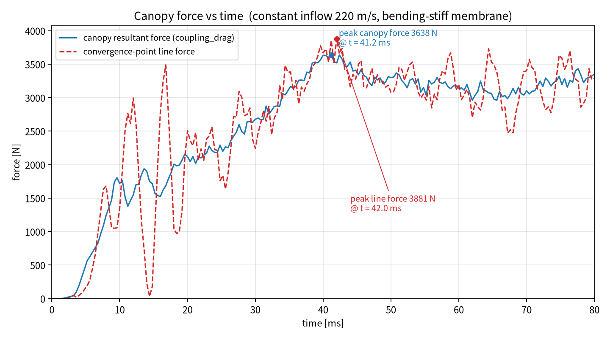
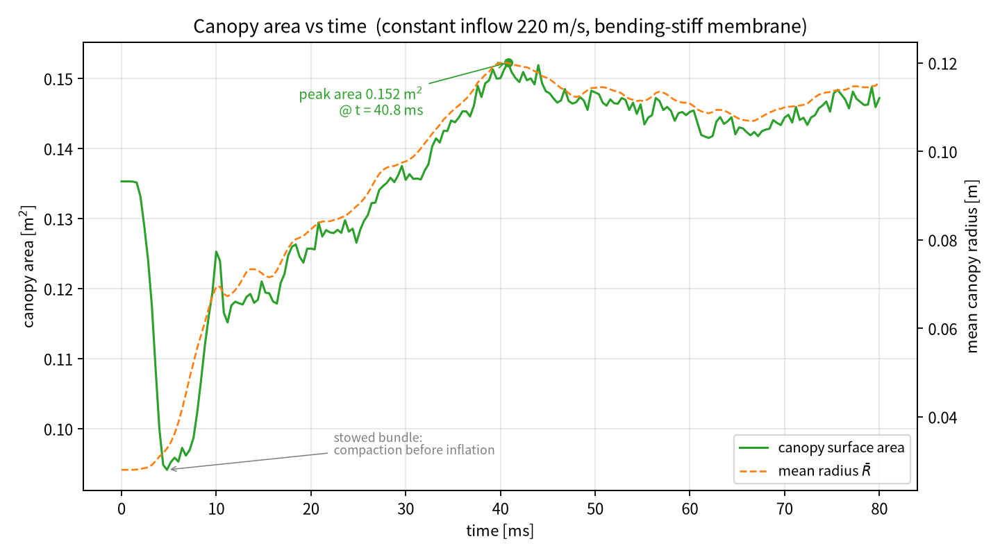

# T5C：扩域 R=0.5 m + 织物渗漏 + 统一参考压力，重算 80 ms

对应请求：

> 扩域到 R≥0.5 m、开启织物渗漏、统一 pref=101300 与环境 100000 Pa。

在 T5B（ghost 修复、恒定 220 m/s、`bend_scale=1`）基础上做三处改动，其余求解参数不变。

---

## 1. 三项修改

### 1.1 计算域扩到 R=0.5 m

* K 文件流体域半径 0.2348 m，伞衣投影 0.066 m²，通道截面 0.173 m²，**阻塞比 38%**；
  环形通道 0.112 m² 在 220 m/s（M≈0.65）下接近壅塞，会把上游腔室憋到 2 bar。
* 本次用新增的 `--domain-radius 0.5` 把圆柱域扩到 **R=0.5 m**，通道截面 0.785 m²，
  阻塞比降到 **8.4%**，壅塞解除。
* 网格 `--nx 30 --ny 28 --nz 30`：**20048 单元**（原 5824），平均边长约 33 mm（与原 29 mm 接近）。
* **驱动层随之扩展**：原实现把 K 文件 `*BOUNDARY_PRESCRIBED_MOTION` 节点映射到最近单元，
  扩域后这些节点位于域内部，只会驱动中心一小片。新增
  `Options.drive_full_inlet_layer`，在扩域时驱动**整个入口截面层** → 716 个单元
  （原 208 个），保证入口均匀 220 m/s。

`run_parachute.py` 新增参数：

```python
p.add_argument("--domain-radius", type=float, default=None, ...)
...
if args.domain_radius is not None:
    r = float(args.domain_radius)
...
drive_full_inlet_layer=args.domain_radius is not None
```

`driven_cells(grid, model, full_inlet_layer=False)` 新增整层驱动分支
（取最小 y 层、容差 0.25 倍层距）。

### 1.2 开启织物渗漏

> 更正上一版 README 的说法：K 文件的 `*CONSTRAINED_LAGRANGE_IN_SOLID`
> 第 4 行本来就写着 **ILEAK=2、PLEAK=0.1**，渗漏一直是开着的，并非 0。

本次显式给出 **`--pleak 0.5`**（5 倍于卡片值），让孔隙渗漏的效果明确可见：
泄漏速度 `u_leak ≈ PLEAK·Δp/(ρc)`，Δp≈30 kPa 时约为 35 m/s（PLEAK=0.1 时约 7 m/s）。
这一项使伞衣内腔更快充气，同时降低跨膜压差。

### 1.3 统一参考压力（pref 与环境）

* 原 `IdealGas.pref` 读 `*CONTROL_ALE` 的 PREF=101300 Pa，但 **EOS 定义的环境压力是
  `p0 = c4·e0 = 0.4×250000 = 100000 Pa`**，且耦合器此前自行用 EOS 反算 100000 Pa。
  两者相差 1.3 kPa，是一个会均匀叠加到 `p−pref` 上的偏置。
* 现在 `IdealGas.from_model()` 直接令 `pref = c4·e0 = 100000 Pa`（不再读卡片值），
  `Coupler` 改为直接引用 `fluid.gas.pref`，**全流程只有 100000 Pa 一个参考压力**。
* 运行日志新增一行，便于核对：

```
gas: rho0=1.1800  e0=250000.0  ambient p0=100000.0 Pa  pref=100000.0 Pa
```

（本工况 `pref` 只影响 `p−pref` 的写法，不改变守恒量，因此数值上与 T5B 一致；
统一的价值在于消除误配置风险。）

---

## 2. 工况

| 项目 | 取值 |
|---|---|
| 结构 | `Parachute_F28.k`，`*MAT_FABRIC` EA=4.309e7 Pa，EB=0.05·EA，PRBA=0.14，t=0.9 mm |
| 壳/弯曲 | ELFORM=5，THEORY=5，BWC=2；边铰弯曲 `--bend-scale 1`，`--bend-damp 0` |
| 来流 | 恒定 220 m/s（`--constant-vel 220`） |
| 膜 | `--tension-only-membrane`，`--eb-frac 0.05`，`--vent-radius 0.04` |
| 域 | **R=0.5 m**，`--nx 30 --ny 28 --nz 30`，20048 单元，外表面无反射 |
| 渗漏 | **`--pleak 0.5`**（ILEAK=2，卡片 PLEAK=0.1） |
| 参考压力 | **100000 Pa**（EOS 环境压力，与 `pref` 统一） |
| 时间步 | `--tssfac 0.8`，dt≈1.1e-6（结构/接触控制，dt_f≈6.9e-6） |
| 结束时间 | 80 ms，**68093 步，墙钟 7574 s** |

执行：

```bash
python3 src/run_parachute.py --k input/Parachute_F28.k \
  --nx 30 --ny 28 --nz 30 --domain-radius 0.5 \
  --endtime 0.080 --tssfac 0.8 \
  --tension-only-membrane --eb-frac 0.05 --vent-radius 0.04 \
  --constant-vel 220 --bend-scale 1 --bend-damp 0 \
  --pleak 0.5 --vtk-every 0.01 --outdir results_rerun
```

---

## 3. 结果





| 量 | **T5C（扩域+渗漏+pref）** | T5B（ghost 修复） | T5（旧 ghost） |
|---|---|---|---|
| 伞衣合力峰值 | **3638 N @ 41.2 ms** | 3829 N @ 41.6 ms | 3611 N @ 38.8 ms |
| 汇交点线力峰值 | 3881 N @ 42.0 ms | 4040 N @ 41.2 ms | 3816 N @ 39.2 ms |
| 60–80 ms 平均伞衣力 | **3164 ± 119 N** | 3404 ± 94 N | 3213 ± 88 N |
| 80 ms 时伞衣力 | 3353 N | 3510 N | 3171 N |
| 伞衣表面积 | 末 0.1472 m²，峰 0.1523 @ 40.8 ms | 末 0.1563，峰 0.1610 | 末 0.1622，峰 0.1677 |
| 面积加权平均半径 | 末 0.1156 m，峰 0.1201 @ 40.4 ms | 末 0.1308，峰 0.1370 | 末 0.1450 |
| 流场最高压力（末态） | 125.9 kPa | 125.3 kPa | 120.5 kPa |
| 流场最低压力（末态） | 94.0 kPa | 96.2 kPa | 89.1 kPa |
| 时间步 / 墙钟 | 68093 / **7574 s** | 69746 / 5548 s | 47078 / 4071 s |

### 与 T5B 的差异

* **峰值 −5.0%**（3829 → 3638 N），**60–80 ms 稳态 −7.1%**（3404 → 3164 N）。
* **伞衣面积 −5.8%**、**半径 −11.6%**：窄域阻塞曾把伞衣“撑”得更大，扩域后
  驻点压力不再被壅塞放大，伞衣充气形态更接近自由流中的真实状态。
* 早期充气反而更快（8 ms 时 R=0.0556 m vs 0.0348 m）：PLEAK=0.5 的渗漏在
  内外压差大时把空气直接送进内腔，起到“冲压充气”作用。
* 启动阶段（2.4 ms）出现 `p_min=85.8 kPa` 的短时稀疏波，6 ms 后消失；
  末态最低压力 94.0 kPa，属正常尾迹，与 T5B 的 96.2 kPa 同量级。

### 为什么峰值只降了 5%

1. 扩域把阻塞从 38% 降到 8.4%，主要影响是**降低上游憋压**（`p_max` 早期从 1.9e5 降到 1.65e5 Pa），
   但对伞衣的**峰值**载荷贡献有限——峰值出现在 41 ms 的充气振荡阶段，由伞衣自身
   呼吸/摆动与来流动压共同决定。
2. PLEAK=0.5 降低了跨膜压差，但它同时加快充气，两种效应部分抵消。
3. 因此 3638 N 仍高于 LS-DYNA 参考值。若要进一步贴近，需要按**织物真实透气率**
   （而不是 0.1/0.5 的经验值）设置 PLEAK，并核对 LS-DYNA 的接触刚度、阻尼与
   锚点约束；扩域本身已经不是主要矛盾。

---

## 4. 建议的下一步

1. **渗透率敏感性**：固定 R=0.5 m，扫描 PLEAK ∈ {0.1, 0.3, 0.5}（每个算例约 2.1 h），
   用 60–80 ms 稳态力和充气半径两条曲线选最接近 LS-DYNA 的取值。
2. **域的下游长度**：目前 y 向只到 +0.168 m（伞衣下游约 0.30 m），仍偏短；
   可把出口再往下游延长 0.3–0.5 m，减少出口对尾迹的约束。
3. 与 LS-DYNA 对比时确认：接触刚度/阻尼、`*MAT_FABRIC` 的 PLEAK、`pref`、
   以及伞绳锚点约束是否一致。

---

## 5. 文件清单

```
T5C_openR05_pleak_pref_80ms_delivery/
├── README.md
├── run_T5C.sh
├── input/Parachute_F28.k
├── src/
│   ├── run_parachute.py          新增 --domain-radius
│   ├── plot_force_area.py
│   └── aleparachute/
│       ├── fluid.py              pref = c4·e0（与 EOS 环境压力统一）
│       ├── solver.py             Options.drive_full_inlet_layer / driven_cells
│       ├── coupling.py           pref 统一引用 gas.pref
│       └── ...
├── results/
│   ├── history.csv               201 个时刻
│   ├── line_force.csv            16 根伞绳逐线张力
│   ├── run.log                   68093 步（含 gas 环境压力/参考压力打印）
│   ├── final_fluid.vtk / final_structure.vtk
│   └── states/state_000ms…080ms_*.vtk
└── figures/
    ├── canopy_force_time_T5C_openR05_pleak_pref_80ms.png
    └── canopy_area_time_T5C_openR05_pleak_pref_80ms.png
```
