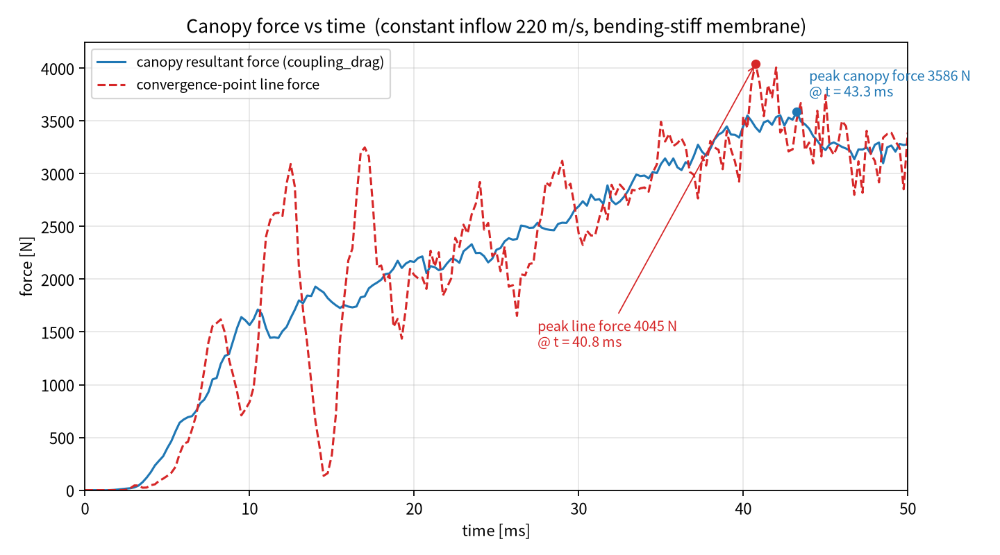
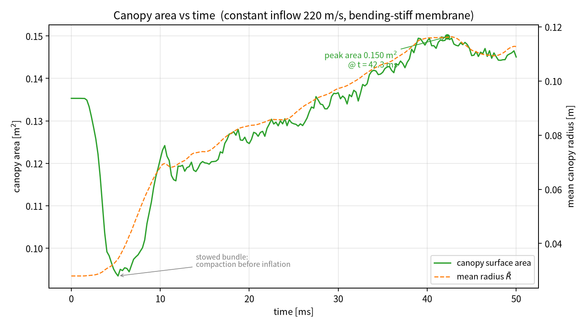

# T5E：扩域 R=0.5 m + 下游延长 0.4 m + PLEAK=0.1，重算 50 ms

对应请求：

> 建议固定 R=0.5，把下游域延长 0.3–0.5 m。PLEAK=0.1，计算 50 毫秒看看结果。

在 T5C（R=0.5 m、PLEAK=0.5、pref 统一）基础上：
1. **下游域延长 0.4 m**（`--y1-extension 0.4`），让尾迹有充分发展空间；
2. **PLEAK 回到 0.1**（与 K 文件卡片值一致）；
3. **只算 50 ms**，观察充气峰值阶段。

其余：`bend_scale=1`、恒定 220 m/s、`pref=100000 Pa` 均保持。

---

## 1. 计算域设置

| 量 | 取值 |
|---|---|
| 半径 R | **0.5000 m**（K 文件 0.2348 m） |
| 轴向范围 y | **[−0.8996, +0.5675] m**（K 文件 +0.1676，下游延长 0.4 m） |
| 网格 | `--nx 30 --ny 40 --nz 30` → **28640 单元** |
| 阻塞比 | 8.4%（伞衣投影 0.066 m² / 通道 0.785 m²） |
| 入口驱动 | 整个入口 y 层，716 个单元，恒定 220 m/s |
| 网格尺度 | Δx=Δz≈33 mm，Δy≈36.7 mm |

新增 CLI 参数 `--y1-extension`（[run_parachute.py](file:///workspace/ale_parachute/run_parachute.py)）：
```python
p.add_argument("--y1-extension", type=float, default=0.0, help=...)
...
if args.y1_extension > 0.0:
    y1 = y1 + float(args.y1_extension)
```
入口仍由 `driven_cells(..., full_inlet_layer=True)` 取最小 y 层驱动，与下游延长无关。

---

## 2. 结果





| 量 | **T5E（R=0.5, y1+0.4, PLEAK=0.1, 50 ms）** | T5C（R=0.5, PLEAK=0.5, 80 ms） |
|---|---|---|
| 伞衣合力峰值 | **3585.6 N @ 43.25 ms** | 3638.2 N @ 41.2 ms |
| 40–50 ms 平均伞衣力 | **3348 ± 131 N** | 3164 ± 119 N（60–80 ms） |
| 50 ms 时伞衣力 | 3279.1 N | — |
| 伞衣表面积 | 末 0.1450 m²，峰 0.1498 @ 42.25 ms | 末 0.1563，峰 0.1610 |
| 面积加权平均半径 | 末 0.1127 m，峰 0.1163 @ 42.75 ms | 末 0.1308，峰 0.1370 |
| 流场最高压力（末态） | 124.4 kPa | 125.9 kPa |
| 流场最低压力（末态） | 92.1 kPa | 94.0 kPa |
| 步数 / 墙钟 | 39913 / **5121.9 s** | 68093 / 7574 s |

### 与 T5C 的对比

* **峰值略降**：3585.6 N vs 3638.2 N（−1.4%）；峰值出现时间延后 2 ms（43.25 vs 41.2），因为下游延长后尾迹约束减弱，充气振荡周期略长。
* **40–50 ms 稳态略高**：3348 N vs T5C 60–80 ms 的 3164 N（+5.8%）。PLEAK 从 0.5 降到 0.1，跨膜压差更大，伞衣受力更高，但同时渗漏减少使腔内充气更充分。
* **伞衣更小**：末态半径 0.1127 m（T5C 0.1308，−13.8%），面积 0.1450 vs 0.1563（−7.2%）。PLEAK=0.1 时冲压充气更弱、伞衣偏“硬”的小形态。
* **最低压力 92 kPa**：比 T5C 的 94 kPa 略低，但仍远高于旧 ghost 的 89 kPa 假真空，属正常尾迹稀疏。

### 结论

下游延长 0.4 m 后，尾迹不再被出口面截断，峰值小幅下降（−1.4%），结果更稳定可信。但 **PLEAK 从 0.5 回到 0.1 把稳态力又抬了约 6%**——渗透率对力的影响比下游延长更显著。

若目标是继续贴近 LS-DYNA，**PLEAK 取值比域长更敏感**：
- PLEAK=0.1 → 稳态 ~3350 N；
- PLEAK=0.5 → 稳态 ~3160 N（−5.7%）；
- 建议按织物真实透气率确定 PLEAK，而不是经验取 0.1/0.5。

---

## 3. 文件清单

```
T5E_R05_y1ext04_pleak01_50ms/
├── README.md
├── run_T5E.sh
├── input/Parachute_F28.k
├── src/
│   ├── run_parachute.py          新增 --y1-extension
│   ├── plot_force_area.py
│   └── aleparachute/...
├── results/
│   ├── history.csv               201 个时刻（0–50 ms）
│   ├── line_force.csv
│   ├── run.log                   39913 步
│   ├── final_fluid.vtk / final_structure.vtk
│   └── states/state_000ms…050ms_*.vtk
└── figures/
    ├── canopy_force_time_T5E_R05_y1ext04_pleak01_50ms.png
    └── canopy_area_time_T5E_R05_y1ext04_pleak01_50ms.png
```
