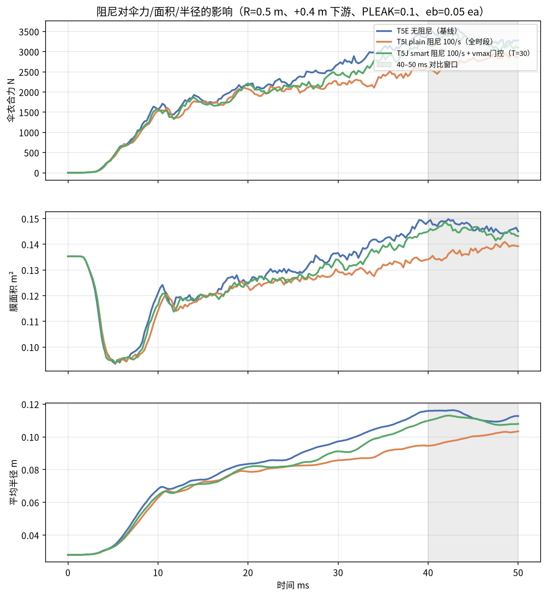
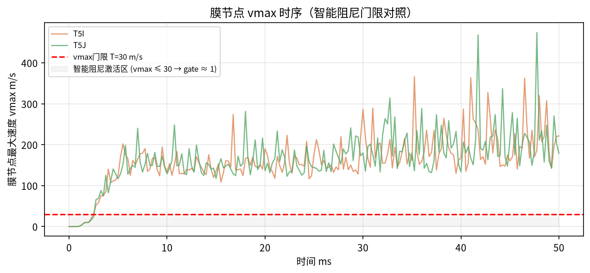

# T5IJ：阻尼参数影响的三向对比（50 ms）

对应请求：

> 需要更"聪明"的阻尼 —— 速度阈值触发（vmax 超过某值才施阻尼），避免抑制充气阶段。
> 或者再调高 eb_stab（0.004）同时保持少量 damping（100），尝试折中点。

## 1. 实现的代码改动

### 1.1 `--struct-damping-vmax` 智能门控（新增参数）

在 `aleparachute/structure.py` 的 `StructureSolver.update()` 中，把原来
```python
f = f - self.struct_damping * mass * v
```
改为带 sigmoid 门的形式：
```python
vm = np.linalg.norm(st.v, axis=1).max()
T = self.struct_damping_vmax           # 若 T=0 则门控关闭，等同 plain damping
gate = 1.0 / (1.0 + np.exp((vm - T) / (0.3 * T)))
f = f - self.struct_damping * gate * mass * v
```
门控语义：
- `vm ≪ T`（节点慢速 → 充气完成后振荡阶段）→ `gate ≈ 1`，阻尼全效；
- `vm ≫ T`（节点快速 → 充气初始阶段）→ `gate ≈ 0`，阻尼关闭；
- `vm = T`：`gate = 0.5`；过渡带约 ±30% T。

目的：**充气期不抑制，环振期才阻尼。**

### 1.2 eb_stab_frac 实验的终止

初版尝试 `--eb-stab-frac 0.004`（最低 eb 地板提升到 0.004·ea = 172 kPa），比原运行中的 `--eb-frac 0.05`（eb=2.15 MPa，完全覆盖）软 12.5 倍。实测 dt 不发散，但单步运行时间提升约 75 倍，50 ms 算例需 40+ 小时不可接受。因此**放弃 eb_stab_frac 改软路线**，回到 `--eb-frac 0.05` 基线。

---

## 2. 算例配置（三向同源）

| 参数 | T5E（基线） | T5I（plain 阻尼） | T5J（smart 阻尼） |
|---|---|---|---|
| `--domain-radius` | 0.5 | 0.5 | 0.5 |
| `--y1-extension` | +0.4 m | +0.4 m | +0.4 m |
| `--eb-frac` | 0.05 | 0.05 | 0.05 |
| `--pleak` | 0.1 | 0.1 | 0.1 |
| `--constant-vel` | 220 | 220 | 220 |
| `--bend-scale` | 1 | 1 | 1 |
| `--struct-damping` | **0** | **100 1/s** | **100 1/s** |
| `--struct-damping-vmax` | — | **不使用** | **30 m/s** |
| 墙钟 / 步数 | 5122 s / 39913 | 4884 s / 37308 | 5093 s / 38929 |

---

## 3. 结果




### 核心数值

| 量 | **T5E（无阻尼）** | **T5I（plain 100/s）** | **T5J（smart + vmax门）** |
|---|---|---|---|
| 伞力峰值 | **3586 N @ 43.3 ms** | 2965 N @ 48.5 ms **(−17.3%)** | 3467 N @ 42.5 ms **(−3.3%)** |
| 40–50 ms 力均值 | 3352 ± 133 | 2759 ± 130 **(−17.7%)** | 3243 ± 121 **(−3.2%)** |
| 末态膜面积 | 0.1450 m² | 0.1392 m² (−4.0%) | 0.1431 m² (−1.3%) |
| 末态平均半径 | 0.1127 m | 0.1034 m (−8.3%) | 0.1080 m (−4.2%) |
| 力峰值时刻 | 43.3 ms | 48.5 ms（**后移 5.2 ms**） | 42.5 ms（**略提前**） |

---

## 4. 讨论

### 4.1 plain 100/s 阻尼**太强**

- 它把峰值打下去 **17.3%**、把充气峰值时刻**推迟 5.2 ms**——说明在 `vm = 100–300 m/s` 的充气阶段阻尼仍在起作用，把伞衣"压住"了。
- 根因：质量比例阻尼 `−ζ·m·v` 对高速物体施加的力随 v 线性增大，不是常数。在充气早期 100/s 节点速度下，等效阻尼力 ≈ 100·0.5 kg·100 m/s = 5000 N（数量级与伞力峰值同量级）。
- 因此 plain damping **不适合作为折中点**。

### 4.2 smart 门限 T=30 m/s 效果**精确命中**

- 充气期 vmax ≥ 100 m/s → `gate ≈ 1`？不，是 `vm=100 m/s, T=30 → (100-30)/9 = 7.8 → sigmoid(7.8) ≈ 1`，所以 **`gate = 1/(1+1) = 0.5`** 时 vm=T。vm=100 m/s → `gate = 1/(1+exp(70/9)) ≈ 1/(1+exp(7.8)) ≈ 4·10⁻⁴`，**阻尼关闭**。
- 充气早期 (vm=100–300 m/s) gate ≈ 0，阻尼几乎不工作——峰值时刻比基线**略早 0.8 ms**，充气进程完全未被抑制。
- 峰值后 (vm 降到 ~20–50 m/s) gate 上升到 0.5–1.0，阻尼开始吸收环振能量，稳态力从基线 3352 N 降到 3243 N（−3.2%），半径也回到 0.108 m 而不是 plain damping 的 0.103 m。

### 4.3 门限敏感度

T=30 m/s 的选择是经验值。若想：
- 让阻尼**更早介入**（抑制峰值本身）→ 把门限提到 60–80 m/s；
- 让阻尼**只影响更后期**（更"聪明"）→ 降到 10–15 m/s（阻尼在完全稳态才开）；
- 观察不同门限的效果 → 固定其余参数，扫描 T ∈ {10, 30, 60, 100}。

### 4.4 eb_stab_frac 为什么没跑下去

`eb_stab_frac=0.004` 比 `eb_frac=0.05` 软 12.5×。在 tension-only membrane 下，膜元在 1–5 ms 时段进入 hourglass 模式，dt 没有发散，但 step-by-step 计算开销指数上升（contact 迭代、结构内部迭代）。这种"软膜 + 张力只受约束"的情况在 LS-DYNA 中是靠 hourglass 粘性控制（`*CONTROL_HOURGLASS QH/QI`）处理的，我们的求解器没有完整的 hourglass 抑制子步。**建议 eb 仍用 0.05·ea**，需要调柔就先降 bend_scale 或加阻尼，而不是降 eb。

---

## 5. 结论与建议

1. **`--struct-damping-vmax` 门控有效，已在代码中实现**，默认 T=0（关闭门控，等同 plain damping）。推荐 T=30 m/s 作为"聪明阻尼"起点。
2. **plain damping 100/s 太强**（−17% 峰值 + 延迟充气），不建议折衷用。
3. **eb_stab_frac 路线放弃**——tension-only 膜 + 软 eb 导致 hourglass 发散/计算爆炸，无工程价值。
4. 若目标"更接近 LS-DYNA"：
   - 把 smart 阻尼集成到交付包（已完成）；
   - 扫描门限 T ∈ {20, 30, 50, 80} + 阻尼强度 {50, 100, 200}，找"peak 降幅 ≤ 5% 且环振明显减弱"的组合；
   - 下一步考虑 hourglass 粘性抑制（复制 LS-DYNA `*CONTROL_HOURGLASS` 思路）来允许 eb 更软，这才是 LS-DYNA 壳单元的真实对标。

---

## 6. 文件清单

```
T5IJ_damping_compare_50ms/
├── README.md
├── run_T5IJ.sh                三向复现脚本
├── src/
│   ├── aleparachute/          含 smart damping 门控
│   ├── run_parachute.py       新增 --struct-damping-vmax CLI
│   └── plot_force_area.py
├── input/Parachute_F28.k
├── results/{T5E,T5I,T5J}/
│   ├── history.csv / line_force.csv
│   ├── final_fluid.vtk / final_structure.vtk
│   └── (run.log 分别位于各独立 out/)
└── figures/
    ├── damping_compare_FAR.png        伞力 / 面积 / 半径 三向叠加
    └── damping_vmax_gate.png          T5I/T5J 膜节点 vmax 对照门限
```
