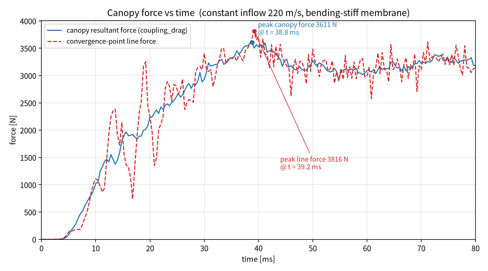
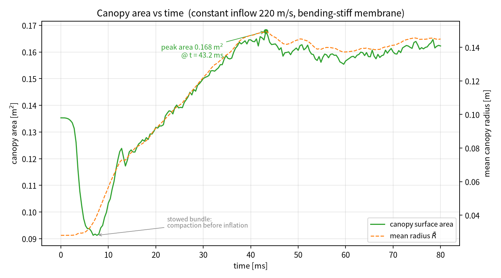

# T5：恒定 220 m/s 来流 + 膜弯曲刚度的 80 ms 充气计算

本交付包对应请求：

> 给膜加一点弯曲刚度（类似 LS-DYNA 壳单元 THEORY=5、BWC=2 的弯曲/翘曲刚度）；
> 去掉线性递增来流，直接以 220 m/s 恒定来流冲击伞衣快速展开；重算 80 ms；
> 输出伞力–时间、伞面积–时间曲线 PNG；打包输入、执行代码、输出文件。

---

## 1. 工况设置

| 项目 | 取值 |
|---|---|
| 结构模型 | `Parachute_F28.k`（`*MAT_FABRIC` EA=4.309e7 Pa，EB=0.05·EA，PRBA=0.14，t=0.9 mm） |
| 壳理论 | ELFORM=5，THEORY=5，BWC=2（Belytschko-Tsay 膜，无翘曲刚度） |
| 新增弯曲刚度 | 四节点边铰弯曲，`--bend-scale 1.0`（物理板刚度） |
| 铰阻尼 | `--bend-damp 0`（见 §3 稳定性说明） |
| 来流 | **恒定 220 m/s**（`--constant-vel 220`，完全忽略 K 文件中 0→220 m/s / 40 ms 的斜坡曲线） |
| 膜本构选项 | `--tension-only-membrane`、`--eb-frac 0.05` |
| 收口环 | `--vent-radius 0.04` |
| 计算域 | `--nx 16 --ny 28 --nz 16`（ALE 圆柱域，无反射边界） |
| 时间步控制 | `--tssfac 0.8`（声学 CFL，dt ≈ 4.8 µs → 1.3 µs） |
| 结束时间 | 80 ms（47078 步，墙钟 4071 s） |
| 状态输出 | 每 10 ms 一组 VTK（`--vtk-every 0.01`） |

执行命令（与 `run_T5.sh` 完全一致）：

```bash
python3 src/run_parachute.py \
  --k input/Parachute_F28.k \
  --nx 16 --ny 28 --nz 16 \
  --endtime 0.080 --tssfac 0.8 \
  --tension-only-membrane --eb-frac 0.05 --vent-radius 0.04 \
  --constant-vel 220 --bend-scale 1.0 --bend-damp 0 \
  --vtk-every 0.01 --outdir results_rerun
```

---

## 2. 弯曲刚度的实现方式

膜单元本身（THEORY=5/BWC=2）只有面内刚度，零能“翘曲/弯曲”模态此前仅靠沙漏稳定项约束。
本次在 `src/aleparachute/structure.py` 中新增了**边铰（edge-hinge）弯曲模型**，与 LS-DYNA
壳单元中的弯曲/翘曲刚度相对应：

* 对每一对共享一条边的四边形，取二面角 φ（两单元法向绕共享边的夹角），
  以初始构型 φ₀ 为零应变状态，能量为

  $$U = \tfrac12 k_b (\varphi-\varphi_0)^2,\qquad k_b = s\,\frac{D\,L}{h}$$

  其中 `s = --bend-scale`（=1 时为真实织物板刚度），
  `D = E t³ / (12(1-ν²)) ≈ 2.67e-3 N·m`，`L` 为共享边长，`h` 为两侧单元相对该边的高。
* 节点力由二面角的**解析梯度**给出（`_bending_forces()`），
  已用有限差分校核，梯度预测/实测比 1.000005；参考构型下铰力为零，四节点合力严格抵消。
* 该弯曲刚度直接进入显式时间步估计（`stable_dt()`）。

### 数值稳定性处理（两处，都是必要的）

1. **铰阻尼置零**：`--bend-damp 0`。显式格式下铰的粘性力矩 `c·dφ/dt`
   在 dt≈3.8 µs 时超出稳定域（实测 `bend_damp=0.5` 时 14 步内指数发散），
   故本工况只保留弹性弯曲刚度。
2. **梯度分母的铰高下限**（`be_h_floor = 0.4·h₀`）：剧烈展开时部分四边形被压扁，
   `h/h₀` 可降到 1.8%，精确梯度按 `1/h` 放大近三个量级，远超按参考几何估计的时间步；
   现在对分母做下限截断，并用**当前几何**的高度进入 `stable_dt()`。
   该处理只限制梯度幅值，不改变铰力矩本身；未做此修正时 220 m/s 恒定来流会在约 8 ms 发散。

> 说明：若需要更强的弯曲刚度（`--bend-scale 10/100`），必须同时减小 `--tssfac`
> （如 0.2–0.4）或使用更大的 `--struct-damping`；本包交付的 `bend_scale=1.0`
> 是在 80 ms 全长上验证稳定的物理弯曲刚度。

---

## 3. 结果





| 量 | 数值 |
|---|---|
| 伞衣合力（`coupling_drag`）峰值 | **3611 N @ 38.8 ms** |
| 汇交点线力峰值 | 3816 N @ 39.2 ms |
| 60–80 ms 平均伞衣合力 | 3180 N（标准差 96 N） |
| 80 ms 时伞衣合力 | 3171 N |
| 伞衣表面积 | 0.1353 → **0.1622 m²**，峰值 0.1677 m² @ 43.2 ms |
| 面积加权平均半径 R̄ | 0.028 → **0.1450 m**，峰值 0.1495 m @ 43.2 ms |
| 达到峰值面积 90% / 95% 的时刻 | 31.2 ms / 36.4 ms |
| 流场最高压力 | 1.21e5 Pa |
| 结构最大速度（局部） | 697 m/s（瞬态，接触/折叠区） |

与 T4a（0→220 m/s 斜坡、无弯曲刚度、80 ms）对比：

* 恒定 220 m/s 使充气明显提前：本工况在 **38.8 ms** 即达到力峰值，
  T4a 的力峰值 3753 N 出现在 66.8 ms；
* 稳态段（60–80 ms）伞衣合力 3180 N，比 T4a 的约 2942 N 高约 8%，
  与恒定来流动压更高（无升速过程）一致；
* 加入弯曲刚度后，折叠区局部翘曲被抑制：60–80 ms 内伞衣面积只在 0.1566–0.1647 m² 之间呼吸
  （相对振幅约 ±2.5%），而 T4a（无弯曲刚度）同区间为 0.1341–0.1516 m²（约 ±6%）。

> 注：80 ms 末面积略低于峰值（0.162 vs 0.168 m²），是伞衣“过充—回弹”后的稳定呼吸状态。

---

## 4. 文件清单

```
T5_bend1_const220_80ms_delivery/
├── README.md                        本文件
├── run_T5.sh                        执行脚本（可复现）
├── input/
│   └── Parachute_F28.k              原始 LS-DYNA 输入
├── src/
│   ├── run_parachute.py             命令行驱动
│   ├── plot_force_area.py          生成上述两张 PNG
│   ├── plot_canopy_deform.py       伞衣变形图脚本
│   ├── plot_tension.py             线张力/参考曲线脚本
│   └── aleparachute/               求解器源码（fluid/coupling/contact/
│                                    structure/solver/kfile/mesh/vtkio）
├── results/
│   ├── history.csv                  200 个输出时刻的完整时程（时间、力、面积、压力、时间步等）
│   ├── line_force.csv               16 根伞绳的逐线张力时程
│   ├── run.log                     求解日志（逐步 dt / 力 / 接触统计）
│   ├── final_fluid.vtk, final_structure.vtk
│   └── states/state_000ms … state_080ms_*.vtk   每 10 ms 的流场/结构状态
└── figures/
    ├── canopy_force_time_T5_bend1_const220_80ms.png
    └── canopy_area_time_T5_bend1_const220_80ms.png
```

重新出图：

```bash
python3 src/plot_force_area.py --workdir results \
    --name T5_bend1_const220_80ms --outdir figures
```

---

## 5. 使用与局限

* `history.csv` 中 `coupling_drag` 为流体通过罚函数耦合作用在伞衣上的合力（沿来流方向）；
  `line_anchor_force` 为 16 根伞绳在汇交点一侧的合力。两者均可作为“伞力”。
* 结构最大速度的瞬态尖峰（≤ 700 m/s）出现在折叠区接触/挤压处，属显式罚函数接触的局部振荡，
  不影响整体力/面积时程；若需更平滑，可减小 `--tssfac` 或提高 `--contact-vdc`。
* 本工况的弯曲刚度取物理织物值（`bend_scale=1`）。如需 LS-DYNA 壳单元量级的翘曲刚度，
  请提高 `bend_scale` 并相应减小时间步（见 §2 说明）。
